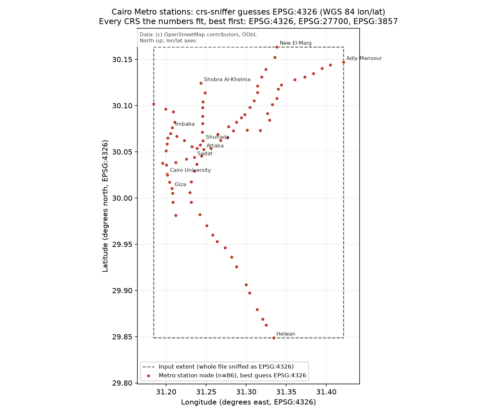

# Showcase: what CRS is a Cairo Metro station file in?

**Question.** A file of Cairo Metro station coordinates arrives without a `crs`
member: which coordinate reference system does crs-sniffer say it is in, and which
other CRSs can the numbers alone not rule out?



- Web map: [index.html](index.html) (Leaflet; serve the folder over HTTP, e.g.
  `python -m http.server -d showcase`, because it fetches `map.geojson`)
- Notebook: [showcase.ipynb](showcase.ipynb) (outputs saved)
- Result data: [map.geojson](map.geojson) (EPSG:4326, x=lon, y=lat, RFC 7946)

## Data

- File: [`data/cairo_metro_stations.geojson`](data/cairo_metro_stations.geojson), 86 point features, about 21 kB.
- Source: OpenStreetMap, queried through the Overpass API
  (`https://overpass-api.de/api/interpreter`) for nodes tagged
  `railway=station` + `station=subway` in the box 29.80-30.25 N, 31.00-31.60 E.
  Only `osm_id`, `name`, `name:en` and `name:ar` are kept; coordinates are
  unchanged (WGS 84 lon/lat as stored by OSM).
- License: [ODbL 1.0](https://opendatacommons.org/licenses/odbl/),
  (c) OpenStreetMap contributors.
- Fetched: 2026-11-15, with [`fetch_data.py`](fetch_data.py). The build itself is offline
  and reads only `data/`.
- The 86 features are OSM station nodes, not distinct stations: "Cairo University" and
  "El-Dabaa Axis" each appear twice (84 distinct English names). OSM coverage of new
  stations may be incomplete.

## Method

[`make_showcase.py`](make_showcase.py) does the following:

1. `crs_sniffer.read_file(path)` reads and validates the coordinates of the file as `(x, y)` pairs.
2. `crs_sniffer.sniff(points)` ranks the known CRSs (EPSG:4326, 3857, 3035, 2154,
   27700) whose approximate extent holds every point.
3. `sniff` is run again on each station on its own, and once on the whole file with
   x and y swapped, to see whether a lat/lon export would be told apart.
4. The output is written as GeoJSON in EPSG:4326 (degrees, lon/lat): one Polygon for
   the input extent (counter-clockwise ring) and one Point per station with its
   `best` code and `candidates`.

No reprojection is done and no distances are computed, so no metric units are involved.
The map axes are longitude/latitude in degrees, scaled by 1/cos(30°) so that ground
distances look equal in both directions.

## Results

- The whole file is ranked **EPSG:4326 (WGS 84 lon/lat)** first, which matches how OSM
  stores coordinates.
- The numbers also fit **EPSG:27700** (British National Grid) and **EPSG:3857**
  (Pseudo-Mercator): values like x≈31.2, y≈30.0 are valid metres in both. The tool
  ranks them lower but cannot exclude them.
- All 86 stations, run one at a time, get the same candidate list
  (`EPSG:4326, EPSG:27700, EPSG:3857`).
- With x and y swapped (lat, lon), the best guess is still EPSG:4326. Near Cairo both
  numbers lie between 29.8 and 31.5, so a swapped axis order cannot be detected from
  the ranges. This matches the "axis order is not distinguished" limitation in the
  main README.
- Input extent: 31.184-31.422 E, 29.849-30.164 N.

## Rebuild

From the repository root:

```
python showcase/make_showcase.py
```

This rewrites `map.geojson`, `index.html` and `map.png` (`map.png` needs matplotlib).
`tests/test_showcase.py` checks that a fresh build produces the committed `map.geojson`,
that the committed notebook runs, and that the station loader rejects malformed files.
